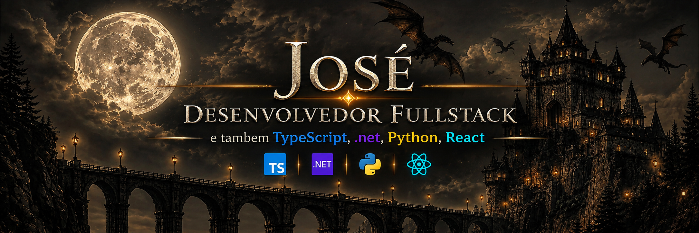
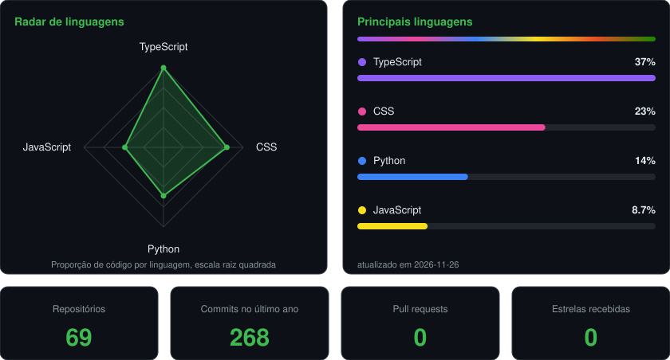
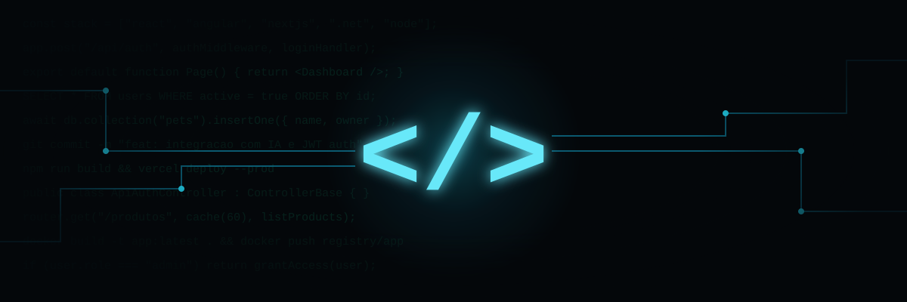

  

<h2 align="center">About Me</h2>

I'm José Mário, a Full Stack developer from Brazil 🇧🇷 — I turn problems into digital products.

- 🔧 **Building now:** SaaS and e-commerce apps with **React, Angular & Next.js**
- 🛠️ **Backend:** **.NET, Node.js & Python** — REST APIs, JWT and cloud
- 🎯 **Focus:** scalable architecture, AI integration and clean code
- 💼 **Open to opportunities** — questions? Feel free to reach out!

<h2 align="center">Languages and activity</h2>

  

<h2 align="center">Contacts</h2>

  
  
  
  

  

